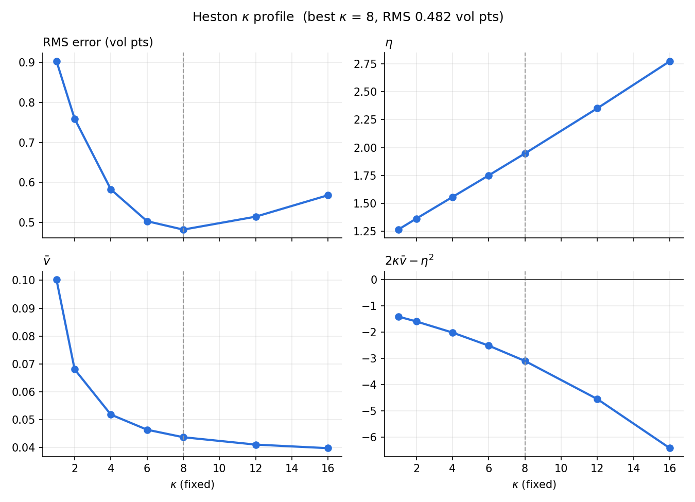

# Heston on SPX: calibration, identifiability, and what breaks

I built this to learn stochastic volatility the way a desk uses it. Pricing inside the model is the easy part. I wanted to fit it to real market data and see where it holds up and where it falls apart. Everything here is priced and calibrated against SPX options I pulled from Bloomberg on 10 Nov 2026.

I kept a running list of things that surprised me or broke along the way in [`notes/cheatsheet.md`](notes/cheatsheet.md). Honestly, that file is the most useful part of the repo.

## What's here

### Pricers

- The Heston characteristic function, written in the numerically stable form that avoids jumps in the complex logarithm at long maturities.
- European calls priced like Black-Scholes, as $S_0 e^{-qT} P_1 - K e^{-rT} P_2$, where the two probabilities are recovered from the characteristic function by numerical integration.
- An FFT pricer that prices a whole strike grid at once: damp the call so it has a Fourier transform, invert with one FFT, then interpolate to market strikes with a cubic spline in log-strike.
- Tests for $\varphi(0) = 1$, $\varphi(-i) = F$, the Black-Scholes limit, and the FFT pricer against the integration pricer.

### Market data and parity

- SPX chain exported from Bloomberg OMON at about 10:30 ET on 10 Nov 2026, with spot at 7528.5. Six expiries, Nov-26 to Dec-28.
- Forwards and rates for each expiry come from regressing $C - P$ on $K$ (put-call parity).
- The implied vols are my own, from Black-76 on my parity forwards. I didn't use Bloomberg's IVM, so every number in the repo sits on the same set of assumptions.

### Calibration

- 875 out-of-the-money options across 5 expiries, Dec-26 to Dec-28. Puts below $F$, calls above $F$, and $0.8 \le K/F \le 1.2$. The Nov-26 expiry had only 10 days left, so I left it out.
- Least squares with vega weights. Dividing each price error by vega turns it into roughly an implied-vol error.
- 20 random starting points spread over the whole parameter box.

## Results

### Fit

The best fit is $v_0 = 0.0338$, $\kappa = 8.14$, $\bar{v} = 0.0435$, $\eta = 1.96$, $\rho = -0.71$, with an RMS error of 0.49 vol points. All 20 starts landed on the same parameters, so local minima weren't a problem on this data.

Residuals below are model IV minus market IV, in vol points.

| Expiry | T (yr) | Options | RMS | Mean | Median half-spread |
|---|---|---|---|---|---|
| 2026-12-18 | 0.10 | 410 | 0.627 | -0.019 | 0.071 |
| 2027-03-19 | 0.35 | 241 | 0.143 | 0.006 | 0.038 |
| 2027-05-21 | 0.53 | 112 | 0.224 | -0.156 | 0.034 |
| 2027-12-17 | 1.10 | 57 | 0.487 | -0.133 | 0.037 |
| 2028-12-15 | 2.10 | 55 | 0.691 | 0.298 | 0.073 |
| All | | 875 | 0.491 | -0.017 | 0.050 |

- The 4- and 6-month expiries fit best, at 0.14 and 0.22 vol points. That's still about 4x and 7x the median half-spread. SPX quotes are tight in vol terms, so quote noise can't explain any of these misfits.
- At 1 month the market smile curves more than Heston can manage. The model sits too low in both wings, by about 1.9 vol points at 80% moneyness and 1.5 at 120%, and too high around 90%. Plotted against strike, the residuals make an S-shape. That points to missing curvature. A plain tilt would have pointed to skew.
- At 1 and 2 years Heston's skew is too flat. The residuals climb steadily from low strikes to high, from about -0.8 to +1.2 vol points at 2 years. With $\kappa$ this high, the model's skew decays with maturity faster than the market's does.
- Some of the pull toward the short end comes from strike counts. The calibration set has 410 options at 1 month and 55 at 2 years, and every option gets equal weight.

### $\kappa$ and $\eta$ aren't separately identified

I fixed $\kappa$ at each value below and refit the other four parameters.

| $\kappa$ | RMS (vol pts) | $v_0$ | $\bar{v}$ | $\eta$ | $\rho$ |
|---|---|---|---|---|---|
| 1 | 0.903 | 0.0326 | 0.1002 | 1.265 | -0.711 |
| 2 | 0.760 | 0.0327 | 0.0680 | 1.364 | -0.710 |
| 4 | 0.583 | 0.0331 | 0.0518 | 1.558 | -0.709 |
| 6 | 0.503 | 0.0334 | 0.0464 | 1.751 | -0.708 |
| 8 | 0.482 | 0.0337 | 0.0437 | 1.947 | -0.707 |
| 12 | 0.514 | 0.0344 | 0.0410 | 2.352 | -0.704 |
| 16 | 0.568 | 0.0351 | 0.0397 | 2.773 | -0.701 |



RMS in this table is the optimizer's vega-scaled error. That's why the best fit shows 0.482 here and 0.491 in the table above, where I inverted to exact implied vols.

Slow mean reversion is ruled out. Anything from $\kappa = 6$ to $16$ fits within 0.09 vol points of the best, though, and $\eta$ rises along with it. On that ridge $\eta/\sqrt{\kappa}$ stays near 0.69. The vanilla surface fixes that ratio and leaves $\eta$ itself loose. $v_0$ and $\rho$ barely move, so those two are well determined.

### The fit violates Feller

$2\kappa\bar{v} = 0.71$ while $\eta^2 = 3.85$, so variance in the fitted model hits zero often. The Fourier pricers don't care. The Monte Carlo does, and this decides how it has to be built for path-dependent products.

### Parity-implied rates sit above Bloomberg's

For expiries past about 4 months, the rate from the parity regression is 22 to 36 bp above the R in Bloomberg's expiry headers. It barely moves when I vary the strike window between 2% and 10% around spot. That fits with SPX box spreads financing above benchmark rates.

Short-dated rates can't be pinned down this way. For Nov-26 the estimate swings by more than 10 percentage points depending on the window. The forwards hold up far better than the rates do, and the forwards are what matter for pricing.

## What's next

- Price forward-start calls at several points along the $(\kappa, \eta)$ ridge. If parameter sets that fit vanillas equally well give different forward-start prices, that gap is vol-of-vol risk, and the vanilla market can't tell you how to price it.
- Autocallables by Monte Carlo, using Andersen's QE scheme because of the Feller violation. Greeks too, including vanna and volga.
- Compare against local vol and Bates (Heston with jumps), and check parameter stability on an earlier snapshot from 3 Nov 2026.

## Repo layout

```
heston/      cf.py           characteristic function (little trap form)
             pricer.py       Gil-Pelaez P1/P2 call pricer
             fft_pricer.py   Carr-Madan FFT + cubic spline in log-strike
             bs.py           Black-Scholes / Black-76 helpers
             params.py       HestonParams
calib/       parity.py       C - P regression for r and F per expiry
             build_set.py    OTM calibration set + own implied vols
             calibrate.py    vega-weighted least squares, multi-start
             kappa_sweep.py  kappa profile
data/        load_bbg.py     reader for the Bloomberg OMON export
             kappa_profile.csv
notebooks/   02_smile.ipynb            how each parameter shapes the smile
             03_calibration_fit.ipynb  model vs market smiles, residuals
plots/       kappa_profile.png
tests/       test_vanilla.py
notes/       cheatsheet.md   running list of what broke and why
```

## Running it

```
pip install -r requirements.txt
pytest -q
```

The Bloomberg export isn't in the repo because of licensing. `data/load_bbg.py` expects the OMON export format, with one sheet per expiry and calls and puts side by side.
